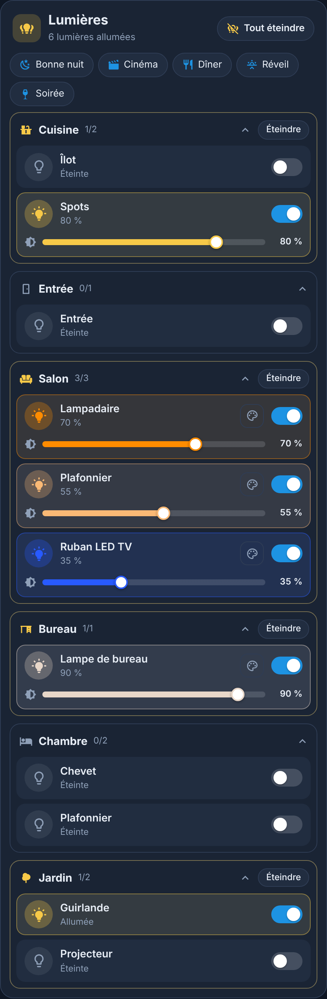
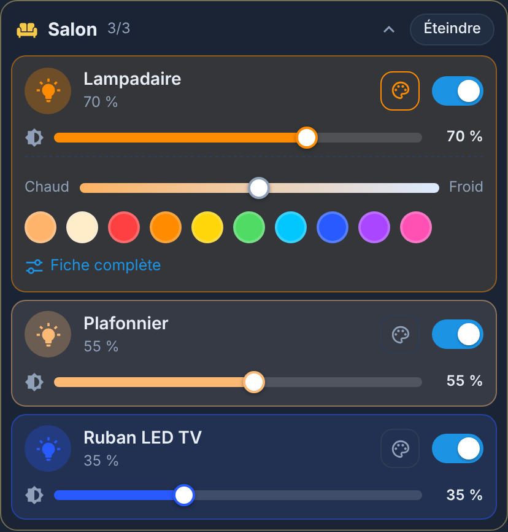
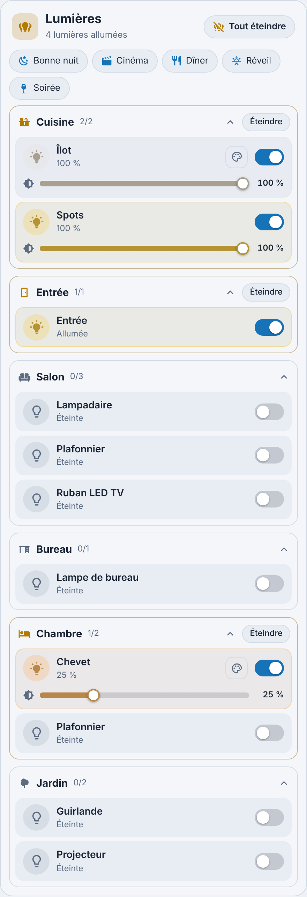
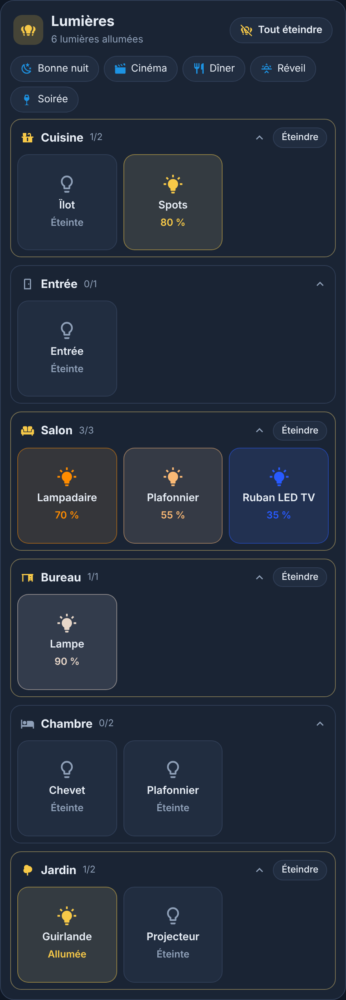
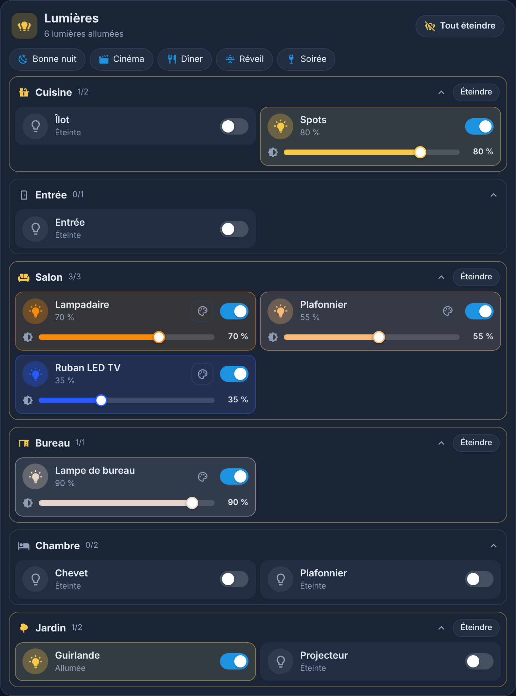

<p>
  ☕ <strong>Si cette carte vous est utile, vous pouvez soutenir le projet :</strong>
</p>

<div style="white-space: nowrap; line-height: 0;">
  <a
    href="https://www.buymeacoffee.com/Marlboro62"
    target="_blank"
    rel="noopener noreferrer"
    style="display: inline-block; text-decoration: none; vertical-align: middle;"
  ></a>&nbsp;&nbsp;<a
    href="https://ko-fi.com/M4M2QL45X"
    target="_blank"
    rel="noopener noreferrer"
    style="display: inline-block; text-decoration: none; vertical-align: middle;"
  ></a>
</div>

# Carte Lumières

[](https://hacs.xyz/)
[](https://github.com/Marlboro62/lumieres-card/releases)

**Toutes vos lumières, rangées par pièce**, dans une carte Lovelace au style des cartes MyElectricalData new ([Carte Enedis Linky New](https://github.com/Marlboro62/content-card-linky-new)), des [Cartes Serveur HA](https://github.com/Marlboro62/serveur-ha-card) et des [Cartes Imprimantes](https://github.com/Marlboro62/printers) : thème bleu nuit, version claire, ou thème Home Assistant.

- **Pièces** : les lumières sont trouvées seules et rangées par pièce (zones de Home Assistant), dans l'ordre des étages. Chaque pièce affiche ses lumières allumées (2/5), se replie d'un clic et a son bouton **Éteindre**.
- **Tout éteindre** : un bouton en haut de la carte, visible dès qu'une lumière est allumée.
- **Luminosité directe** : un curseur sous chaque lumière allumée qui le permet, sans ouvrir de fenêtre.
- **Blanc et couleur** : le bouton 🎨 ouvre un curseur blanc chaud ↔ froid et dix couleurs, selon ce que permet l'ampoule.
- **Scènes** : vos scènes Home Assistant en boutons, en un clic.
- La couleur de chaque ampoule allumée teinte son icône, son curseur et sa ligne.
- **Deux affichages** : en **liste** (curseurs et couleurs directement dans la carte) ou en **boutons** (une tuile par lumière : un appui allume ou éteint, un appui long ouvre la fiche avec luminosité et couleur).
- **Aucune dépendance** : pas de button-card ni de card-mod. Éditeur visuel compris.
- **Français, anglais et polonais** (langue de Home Assistant, ou au choix).

| Soirée | Blanc et couleurs | Clair |
| --- | --- | --- |
|  |  |  |

| Affichage en boutons (`layout: buttons`) | Sur tablette ou PC |
| --- | --- |
|  |  |

*Aperçus réalisés avec la démo : pièces, lumières et scènes fictives.*

**[▶ Essayer la démo en ligne](https://marlboro62.github.io/lumieres-card/docs/demo.html)** : allumez, éteignez, réglez la luminosité, changez la couleur, lancez une scène, en sombre ou clair, sur téléphone ou PC.

## Installation

### Avec HACS

1. Dans **Paramètres › Marketplace** (ou HACS avant Home Assistant 2026.11), menu **⋮** → **Dépôts personnalisés** : adresse `https://github.com/Marlboro62/lumieres-card`, type **Tableau de bord** (Dashboard).
2. Cherchez **Carte Lumières**, téléchargez-la, puis rechargez la page (**Ctrl+F5**).

### Manuellement

1. Copiez `lumieres-card.js` dans `config/www/`.
2. **Paramètres › Tableaux de bord › ⋮ › Ressources** : ajoutez `/local/lumieres-card.js`, type **Module JavaScript**.

## Utilisation

```yaml
type: custom:lumieres-card
```

C'est tout : la carte trouve vos lumières et leurs pièces. Elle est aussi dans la liste des cartes (**Lumières**), avec un éditeur visuel.

| Geste | Effet |
| --- | --- |
| Clic sur l'ampoule ou l'interrupteur | Allumer ou éteindre |
| Curseur | Luminosité (envoyée au relâchement) |
| Bouton 🎨, ou clic sur le nom d'une ampoule couleur | Blanc chaud ↔ froid, couleurs et lien vers la fiche complète |
| Clic sur le nom d'une autre lumière | Fiche de Home Assistant |
| Clic sur le nom d'une pièce | Replier ou déplier la pièce (mémorisé dans le navigateur) |
| Affichage en boutons : appui | Allumer ou éteindre |
| Affichage en boutons : appui long | Fiche de Home Assistant (luminosité, couleur) |

### Options

| Option | Rôle | Défaut |
| --- | --- | --- |
| `title` | Titre | `Lumières` |
| `icon` | Icône du titre | `mdi:lightbulb-group` |
| `areas` | Pièces affichées, dans cet ordre (identifiants de zone) | toutes |
| `exclude` | Lumières à masquer | aucune |
| `layout` | `list` (liste, curseurs et couleurs) ou `buttons` (une tuile par lumière) | `list` |
| `show_off` | Afficher les lumières éteintes | `true` |
| `show_scenes` | Afficher les scènes | `true` |
| `scenes` | Scènes affichées, dans cet ordre | toutes (celles des pièces choisies avec `areas`) |
| `max_scenes` | Nombre de scènes au maximum | `8` |
| `theme` | `v2` (bleu nuit), `auto` (clair si Home Assistant est en mode clair) ou `ha` (thème de Home Assistant) | `v2` |
| `language` | `auto`, `fr`, `en` ou `pl` | `auto` |

Exemple : le rez-de-chaussée, sans les lumières éteintes ni la guirlande, avec trois scènes.

```yaml
type: custom:lumieres-card
title: Rez-de-chaussée
areas:
  - salon
  - cuisine
show_off: false
exclude:
  - light.guirlande
scenes:
  - scene.soiree
  - scene.cinema
  - scene.bonne_nuit
```

### Bon à savoir

- Les lumières **masquées** dans Home Assistant et celles qui servent de réglage (catégorie « configuration » ou « diagnostic ») ne sont pas affichées.
- Une lumière sans pièce apparaît dans **Autres lumières**, en bas de la carte.
- Les noms sont raccourcis : le nom de la pièce et le mot « Lumière » sont retirés (« Lumière Salon Centre » devient « Centre » dans la pièce Salon). Si rien ne reste, le nom complet est gardé.
- Un **groupe de lumières** apparaît comme une lumière ; masquez avec `exclude` le groupe ou ses membres pour éviter les doublons.

## Historique des versions

### 0.1.0

- ✨ Première version : lumières par pièce, tout éteindre, luminosité directe, blanc et couleurs, scènes, thèmes bleu nuit, clair et Home Assistant, français, anglais et polonais.

Détail de chaque version : [releases](https://github.com/Marlboro62/lumieres-card/releases).

## Signaler un problème

Ouvrez une [issue GitHub](https://github.com/Marlboro62/lumieres-card/issues), avec la version de la carte (console du navigateur, F12, ligne **LUMIERES-CARD**) et le YAML de la carte.

## Licence

MIT
